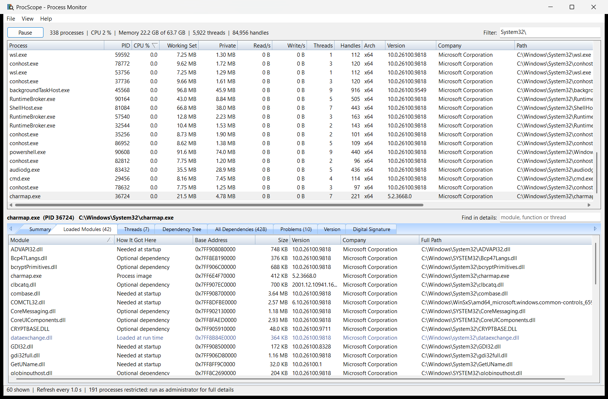
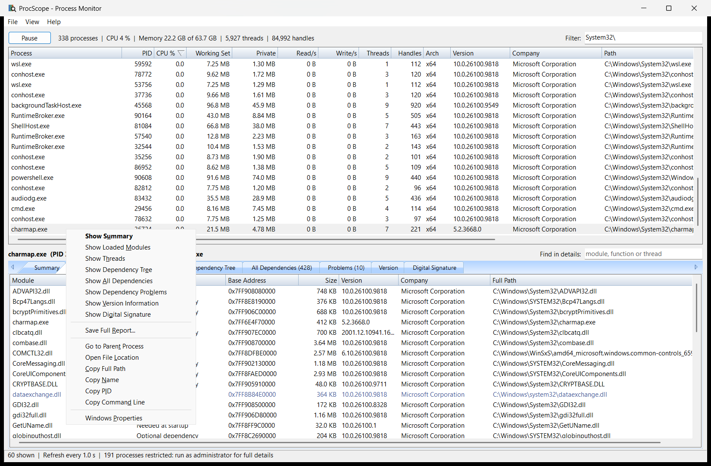
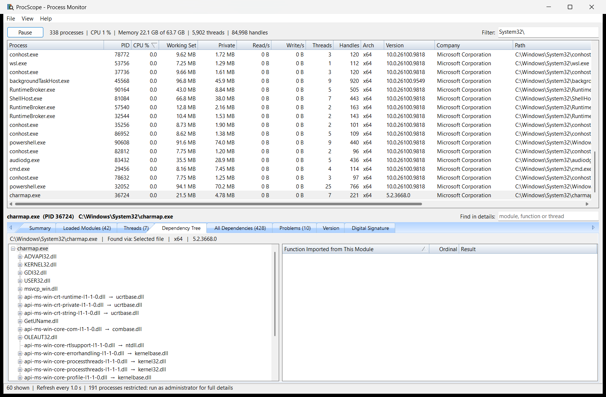
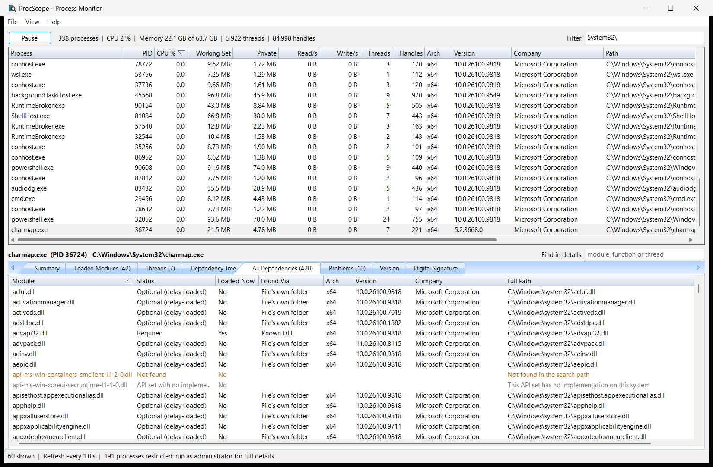
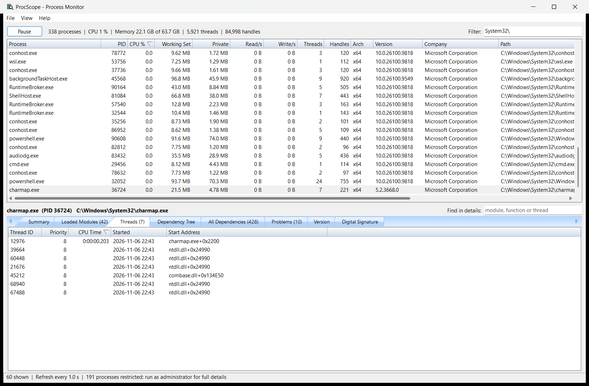
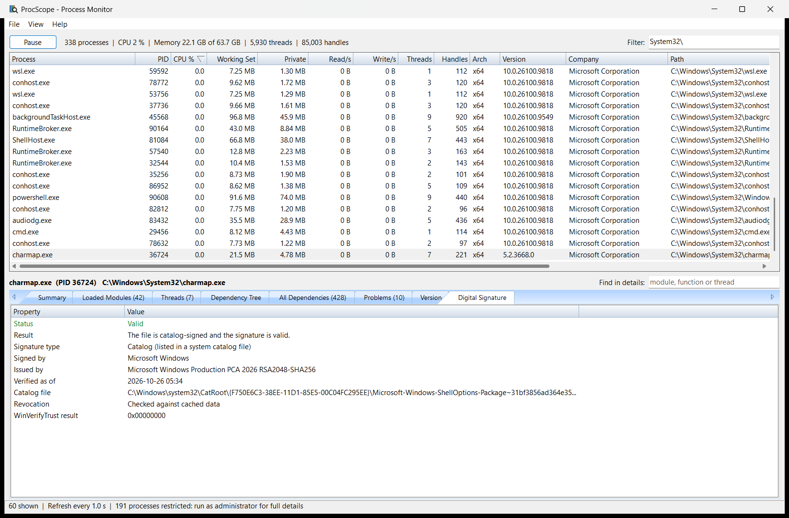

# ProcScope – Windows Process Monitor (C++ / MFC)

Shows running processes live: CPU, memory, disk and I/O activity, threads and handles. For the selected process, it shows the modules really loaded, its threads, and its full dependency chain, down to the individual imported functions.

It only reads. It never ends, suspends or changes a process, and never loads code from one.

## Screenshots

**Live list and loaded modules**: every module a process has loaded, and how it got there: needed at startup, an optional dependency, or loaded at run time.



**Right-click menu**: opens any details tab for that process, saves a report, goes to its parent, or locates its file.



**Dependency tree**: the full chain, with each API set shown next to the DLL that implements it, and the functions the parent needs from the selected module.



**All dependencies**: every module in the chain, with whether it's loaded right now.



**Threads**: each thread's CPU time, priority, start time, and the module it started in.



**Digital signature**: embedded and catalog signatures of the process's file, with the signer.



## Using it

- **Process list**: refreshes every second. Click a column header to sort. **Filter** narrows it by any column. **Pause** freezes it, and **View → Update Speed** changes the interval. The selection follows its process as rows move. Grey rows are processes Windows won't let this user inspect.
- **Selecting a process** loads its details below. Double-click to go straight to its loaded modules. Drag the gap between the panes to resize them.
- **Details tabs**: Summary, Loaded Modules, Threads, Dependency Tree, All Dependencies, Problems, Version, Digital Signature. **Find in details** narrows the module, thread, dependency and problem lists. The Summary tab's figures stay live; loaded modules and threads are read when you select a process, so press **F5** to re-read them.
- If a selected process exits, it's marked `(exited)`, and the last values stay on screen.
- `ProcScope.exe <PID or process name>` starts with that process selected.
- **File → Save Process List as CSV** saves the current list.

### Right-click menus

| On | Commands |
|---|---|
| A process | Show Summary, Loaded Modules, Threads, Dependency Tree, All Dependencies, Dependency Problems, Version Information or Digital Signature; Save Full Report; Go to Parent Process; Open File Location; Copy Full Path, Name, PID or Command Line; Windows Properties |
| A module or dependency | Open File Location; Copy Name; Copy Full Path; Copy Selected Rows; Copy All Visible Rows; Select All |
| A problem | Show in Dependency Tree; Copy Selected Rows; Copy All Visible Rows; Select All |
| A row in another tab | Copy Selected Rows; Copy All Visible Rows; Select All |

### Dependencies

The chain comes from the process's file on disk, and it follows imports, delay-loaded imports and forwarded exports. DLLs are looked for in the order Windows uses: API sets, Known DLLs, the file's own folder, the system folder, the 16-bit system folder, the Windows folder, then `PATH`. Because ProcScope also has the process's real module list, it can compare the two:

| Loaded Modules: How It Got Here | Meaning |
|---|---|
| Process image | The program itself |
| Needed at startup | Windows had to load it for the process to start |
| Optional dependency | In the chain, but only through a delay-load or a forward that isn't needed at startup |
| Loaded at run time | Not in the chain: the program or a library asked for it while running, such as a plug-in |

**Problems** lists DLLs that aren't found or can't be read, functions a DLL doesn't export, and modules of the wrong architecture:

| Severity | Meaning |
|---|---|
| Error | The file can't load: the fault is in a part of the chain Windows must resolve at startup |
| Warning | It only matters if that code runs, such as a missing delay-loaded DLL. An API set with no implementation in the startup chain is also a warning, because these are optional by design |
| Info | An API set with no implementation, outside the startup chain |

Warnings are normal, and most come from Windows' own optional DLLs. The chain is usually hundreds of modules long, because it includes everything that could ever be delay-loaded, while a process loads far fewer: compare the All Dependencies and Loaded Modules counts.

### Limits worth knowing

- **Run as administrator for the full picture.** As a standard user, Windows hides most details of services and other users' processes, so these rows are grey. Elevated, ProcScope enables the debug privilege and can read nearly all of them. Protected processes stay restricted.
- **Use the x64 build on 64-bit Windows.** The 32-bit build can't read the modules of 64-bit processes.
- **CPU % is a share of the whole machine**, so one busy thread on an 8-core machine shows about 12.5. CPU and I/O rates need two samples, so they read 0 in a process's first second.
- **Read/s and Write/s count all I/O**, including network and device I/O, because that's what Windows' per-process counters measure.
- **The dependency chain is worked out from the file**, so it's about what the program can load and not what's happening inside it. Side-by-side manifests aren't followed, except that `comctl32.dll` is checked against the v6 copy in WinSxS. The search assumes the file's own folder is the application's folder and uses ProcScope's own `PATH`. The real process may differ, for example if it changes its search path.
- **Command lines are shown as they are**, and can contain passwords or tokens if a program was started with them. They also appear in saved reports and CSV files, so check before sharing.

## Build

Requires Visual Studio 2022 with *Desktop development with C++* and *C++ MFC for latest v143 build tools*.

```bash
"C:/Program Files/Microsoft Visual Studio/2022/Community/MSBuild/Current/Bin/MSBuild.exe" ProcScope.sln -p:Configuration=Release -p:Platform=x64
```

Output: `bin\x64\Release\ProcScope.exe`. MFC is linked statically, so it runs on its own.

## Tests

```bash
powershell -ExecutionPolicy Bypass -File Tests/CompareProcesses.ps1
```

```bash
powershell -ExecutionPolicy Bypass -File Tests/CompareWithLoader.ps1
```

```bash
powershell -ExecutionPolicy Bypass -File Tests/DependencyFixtures.ps1
```

```bash
powershell -ExecutionPolicy Bypass -File Tests/CompareWithDumpbin.ps1
```

```bash
powershell -ExecutionPolicy Bypass -File Tests/SmokeTest.ps1 -Configuration Release
```

| Test | What it checks |
|---|---|
| `Tests\CompareProcesses.ps1` | The process list, names, memory, thread counts and loaded modules match PowerShell's view of the same processes |
| `Tests\CompareWithLoader.ps1` | On running 64-bit and 32-bit processes, every DLL the chain calls required is really loaded from that path, and no errors are reported |
| `Tests\DependencyFixtures.ps1` | Builds test DLLs with a missing DLL, a missing function, the wrong architecture, an unreadable file, a missing delay-loaded DLL and a broken forward, and checks each is reported with the right severity |
| `Tests\CompareWithDumpbin.ps1` | Exports and imports match Microsoft's `dumpbin`, entry for entry |
| `Tests\SmokeTest.ps1` | The GUI starts, keeps running, and all its threads shut down on close |
| `ReaderTests fuzz <file> <iterations>` | The file readers, the dependency check and the API set parser survive corrupted copies of a file |

## Layout

| Part | Files |
|---|---|
| Live process table, modules and threads (no MFC) | `ProcessSampler.*` |
| Background sampling and loading | `ProcessLoader.*` |
| Details tabs | `ProcessDetailsPane.*`, `DependencyPanel.*` |
| Main window | `ProcScopeDlg.*`, `ProcScope.*` |
| Reports and CSV | `ProcessReport.*`, `Report.*` |
| Owner-data sortable and filterable list | `VirtualList.*` |
| Dependency chain, search order, API sets | `DependencyResolver.*` |
| File readers: PE exports and imports, version, signature, archives | `PeImage.*`, `DllExportReader.*`, `DllImportReader.h`, `FileVersionReader.h`, `FileSignatureVerifier.*`, `LibArchiveReader.*`, `LibraryAnalyzer.*` |

The readers, dependency resolver, list control and dependency tree come from the sibling LibScope project, and the process sampling starts from WinMon's. Each project keeps its own copy.

## Continuous integration

`.github/workflows/build.yml` runs on every push or pull request to `main`, and can also be started by hand:

| Job | What it does |
|---|---|
| Build | Builds Debug and Release for x64 and x86 on `windows-2022`, then runs the smoke test and a short fuzz of the readers on each |
| Verify | Runs the comparisons with PowerShell, `dumpbin` and the Windows loader, and the dependency fixtures |
| Release | On a push to `main` where all of that passes, publishes GitHub release `v1.0.<run number>` with `ProcScope-v1.0.<run number>-x64.zip` and `ProcScope-v1.0.<run number>-x86.zip` (exe + pdb) |

The same version is in the build artifacts' names and in `ProcScope.exe`'s file properties, as `1.0.<run number>.0`. To change the major or minor number, edit `VERSION` at the top of the workflow. A local build is `1.0.0.0` unless you pass `-p:ProcScopeVersion=1.2.3` to MSBuild.

## Setting up a private GitHub repository

Run these from this folder, with [Git](https://git-scm.com/) and the [GitHub CLI](https://cli.github.com/) installed:

```bash
gh auth login
```

```bash
git init -b main
```

```bash
git add .
```

```bash
git commit -m "Add ProcScope process monitor"
```

```bash
gh repo create ProcScope --private --source . --remote origin --push
```

Every push to `main` then publishes a release. Actions on a private repository use your account's monthly allowance, and each push runs five Windows jobs.
